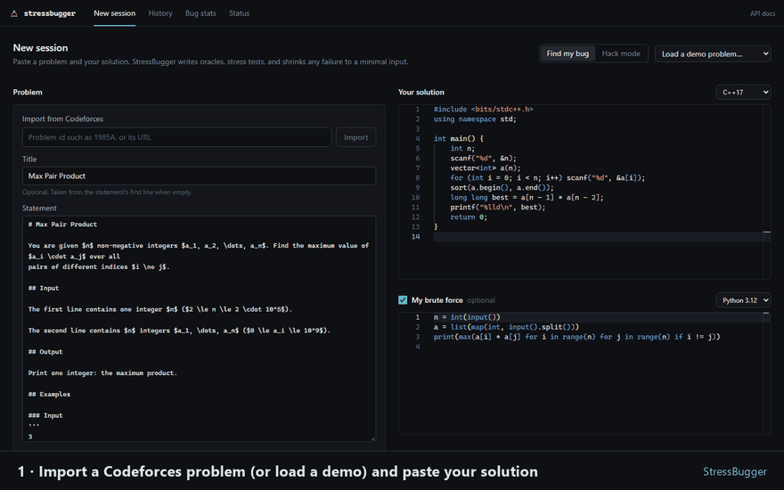
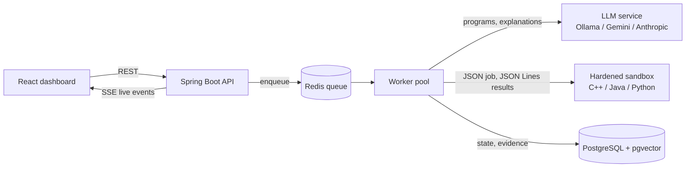

> ## 🔒 StressBugger Source Code
>
> **Public Portfolio • Private Implementation**
>
> 📚 This repository contains the **technical documentation, architecture, demos, and project overview** of StressBugger.
>
> 🔐 The **complete source code is private** to maintain implementation integrity.
>
> 👨‍💻 **Recruiters & Technical Evaluators:**
> [**Request source code access →**](https://github.com/ItsDeadlyProgrammer/stressbugger)
> 📧 **Email:** [hvsr29march2004@gmail.com](mailto:hvsr29march2004@gmail.com)

# 🐞 StressBugger — AI-Guided Stress Tester for Competitive Programming

<h3 align="center">
The LLM proposes. The sandbox proves.
</h3>

  
  
  
  
  
  
  
  

---

## 🚀 What is StressBugger?

You submit a competitive-programming solution and get **Wrong Answer on test 37**, with no idea which input breaks it.
**StressBugger** finds that input for you.

Give it a problem (a Codeforces id such as `1985A`, or any pasted statement) and your solution in **C++17, Java 21 or
Python 3.12**. It:

- 🧪 **writes its own test tools** with an LLM: a test generator, an input validator, a checker and independent brute
  forces;
- ✅ **refuses to trust them blindly**: every program must compile, pass the samples and agree with the others before it
  is used;
- ⚡ **stress-tests your solution** with thousands of seeded tests in a hardened sandbox (~1,000 tests per minute);
- ⚖️ **classifies every disagreement from evidence** (your bug, a wrong brute force, an invalid input, a timeout,
  several valid answers…) with a confidence value;
- ✂️ **shrinks the failing input** to a minimal counterexample, using execution only;
- 💡 **explains the bug and proposes a fix**, which is labelled *verified* only after the sandbox re-runs it on the
  counterexample, every sample, earlier failing inputs and a fresh stress run.

The core idea is a strict separation of roles: **the LLM only writes programs and prose. Every verdict on screen is
decided by running code**, and each one shows the input and all outputs behind it.

---

## 🌐 Live Demo & Media

*   🔗 [**Live dashboard**](https://stressbugger.netlify.app) (React, hosted on Netlify)
*   🔗 [**Backend API + Swagger UI**](https://stressbugger-api.onrender.com/swagger-ui.html) (Spring Boot on Render)
*   🔗 [**Health check**](https://stressbugger-api.onrender.com/api/health?toolchains=true) (compiles and runs a program in every language)
*   🖼️ [**Screenshot gallery**](screenshots/README.md)
*   🎬 [**Video walkthrough**](demo/README.md)

> The demo runs on free tiers: the first request after a quiet period takes about a minute while the server wakes up.

  

---

## 🏗️ System Architecture & Engineering

### From problem to verified fix

### Technical Documentation Index

| Document | What's inside |
|---|---|
| 📂 [**Technical Overview**](docs/technical-overview.md) | the problem, the approach and the full technology stack |
| 📂 [**System Architecture**](docs/architecture.md) | components, the session pipeline, live events, execution |
| 📂 [**Trust & Triage**](docs/trust-and-triage.md) | how LLM-written programs earn trust and how verdicts are decided |
| 📂 [**LLM Integration**](docs/llm-integration.md) | provider abstraction, JSON-schema answers, self-repair, caching |
| 📂 [**Sandbox & Security**](docs/sandbox-and-security.md) | threat model, container hardening, privilege separation |
| 📂 [**Database Design**](docs/database-design.md) | the 10-table schema and how evidence is stored |
| 📂 [**API Documentation**](docs/api-documentation.md) | REST endpoints, Server-Sent Events, payloads |
| 📂 [**Engineering Decisions**](docs/engineering-decisions.md) | key trade-offs and known limitations |
| 📂 [**Project Structure**](docs/project-structure.md) | modules, packages and frontend layout |
| 📂 [**Testing & Verification**](docs/testing-and-verification.md) | test suites, sandbox attack tests, CI, measured results |
| 📂 [**Setup & Deployment**](docs/setup-and-deployment.md) | local Docker setup, free hosting, Linux server |
| 📂 [**Demo Scenarios**](docs/demo-scenarios.md) | the 7 bundled problems and what each one proves |

---

## ✨ Core Features

### 🧠 LLM-written test tools, verified by execution
*   **Generator, validator, checker, brute forces:** written per problem by the LLM from the statement.
*   **Self-repair:** a program that fails to compile or fails a check goes back to the LLM with the error (up to 3 attempts).
*   **Independent oracles:** two brute forces in different approaches and languages, or yours plus one more to cross-check it.

### ⚖️ Evidence-based triage (11 verdicts)
*   `SOLUTION_BUG`, `BRUTE_BUG`, `INVALID_INPUT`, `MULTIPLE_VALID_ANSWERS`, `NONDETERMINISTIC`,
    `SOLUTION_TLE / RE / MLE`, `REFERENCE_TLE / RE` and `ORACLE_DISAGREEMENT`.
*   Each verdict carries a **confidence value** and its reasoning. A high-confidence `SOLUTION_BUG` is never claimed on
    the word of a single unverified brute force.

### ✂️ Shrinking & TLE hunting
*   **Execution-only shrinker:** lowers size parameters, removes elements (fixing the counts), moves values toward 0.
    A candidate is kept only if it still fails *the same way*.
*   **TLE hunter:** bisects the input size to find the smallest input that times out and estimates the complexity
    (e.g. `O(n²)`).

### 💡 Explanations & verified fixes
*   Root cause with **cited lines** checked against your code, plus a patch shown as a diff.
*   A fix is **verified** only if it passes the counterexample, all samples, earlier failing inputs and 300 fresh tests.

### 📡 Live dashboard
*   Every phase streams over **Server-Sent Events**: plan, step states, test progress and an LLM heartbeat with tokens
    written so far.
*   Events are stored, so a dashboard opened late **replays the whole session**.

### 🗂️ Bug memory
*   Bug tags (`overflow`, `off-by-one`, `reset-missing`, `edge-case`…) and **similar past bugs** found through
    pgvector, using a deterministic 256-dimension embedding that works offline with any LLM.

### 🔐 Hardened sandbox
*   One container per session: **no network**, read-only root, memory/CPU/process limits, all capabilities dropped.
*   Untrusted programs run as a **separate user** and are wiped after every run, so they cannot tamper with the oracles
    or the recorded evidence.

### 📥 Codeforces import
*   Paste a problem id or URL: statement, samples and limits are filled in. Samples are copied verbatim, never
    rewritten by the LLM.

---

## 🛠️ Technology Stack

| Layer | Technologies |
| :--- | :--- |
| **Backend** | Java 21, Spring Boot 3.5, Spring AI 1.1, Spring Data JPA, Flyway, springdoc OpenAPI, Jsoup |
| **Frontend** | React 18, TypeScript 5.9, Vite, Tailwind CSS 4, Monaco editor, TanStack Query, Recharts |
| **Data** | PostgreSQL 16 + pgvector (source of truth), Redis 7 (job queue, cancel flags, LLM cache) |
| **Sandbox** | Docker, a Python harness running g++ 13 (C++17), Eclipse Temurin 21, CPython 3.12 |
| **LLM** | Ollama + `qwen2.5-coder` (local, free, default), Gemini, Anthropic, or a mock for offline demos |
| **Testing** | JUnit 5, Testcontainers, Vitest, Testing Library, sandbox attack tests, GitHub Actions CI |
| **Deployment** | Docker Compose, Caddy (HTTPS), Netlify (frontend), Render (backend), Neon (PostgreSQL) |

---

## 📊 By the numbers

| | |
|---|---|
| Backend | ~11,000 lines of Java in 138 files, 14 packages |
| Frontend | ~4,300 lines of TypeScript / React |
| Sandbox harness | ~700 lines of Python |
| Tests | 97 backend unit tests, 22 integration tests, 36 frontend tests, sandbox attack suite |
| End-to-end | all 7 demo problems run through the REST API in CI |
| Throughput | ~1,000 tests per minute per session |
| Hosted demo | a full session in ~4 minutes under a 512 MB memory limit |

---

## 👨‍💻 Author

**Harshvardhan Singh**

---

## ❤️ Note

StressBugger brings together LLM engineering, secure code execution, distributed job processing and a live React
dashboard. Its design goal is that an AI tool should be **checkable**: the model does the creative work, and every
claim it leads to is proven by execution and shown with its evidence.

*If you are interested in discussing the implementation details or architecture, please feel free to reach out.*
