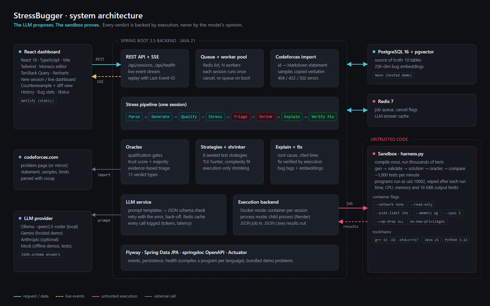
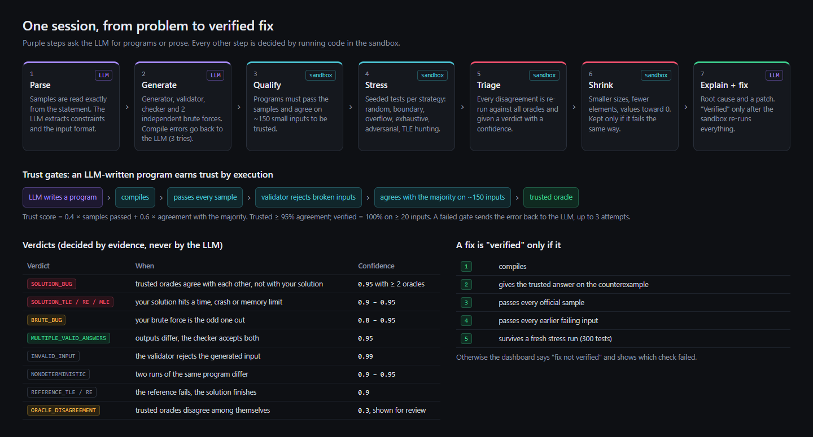

# Architecture Diagrams

| File | Shows |
|---|---|
| [`architecture.png`](architecture.png) | the components: React dashboard, Spring Boot backend, PostgreSQL + pgvector, Redis, the hardened sandbox and the LLM providers |
| [`pipeline.png`](pipeline.png) | one session from problem to verified fix: the 7 phases, the trust gates, the 11 verdicts and the fix verification rules |
| [`architecture-diagram.md`](architecture-diagram.md) | a walkthrough of both diagrams |

Both diagrams match the components described in the [System Architecture](../docs/architecture.md) document, which
also has Mermaid versions that GitHub renders directly.

