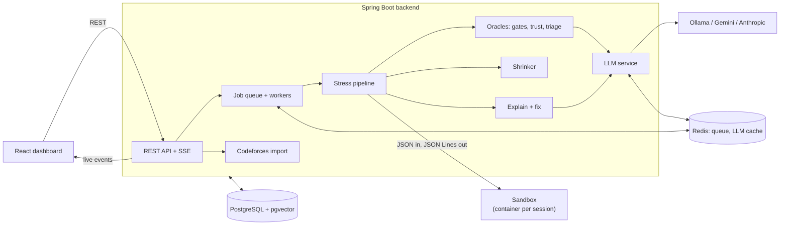
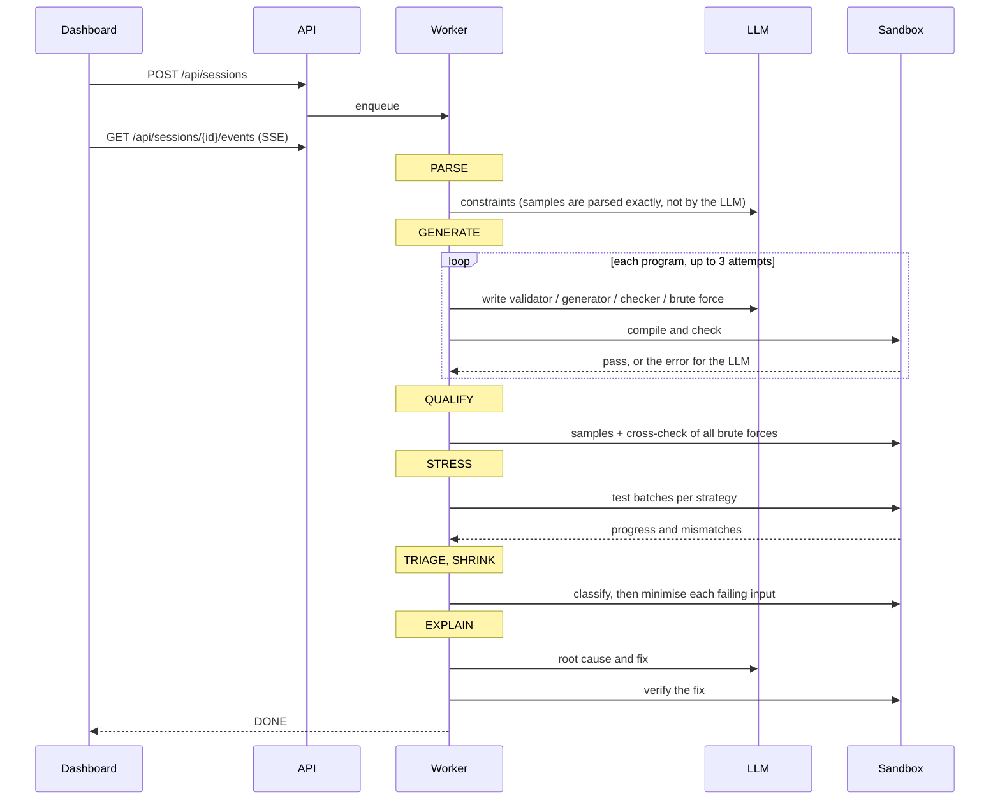

# System Architecture

StressBugger is one Spring Boot service, a static React dashboard, PostgreSQL, Redis and a sandbox image. The backend
never runs untrusted code itself: it sends jobs to a sandbox and reads the results back.

## Components

| Component | Responsibility |
|---|---|
| **REST API + SSE** | create, start, cancel and inspect sessions; stream live events |
| **Queue + worker pool** | sessions wait in a Redis list; N worker threads run them; a conditional update guarantees each session runs once |
| **Stress pipeline** | orchestrates the phases of one session |
| **Oracles** | qualification gates, trust scores, majority vote, triage |
| **Strategies + shrinker** | seeded test strategies, TLE hunter, complexity fit, execution-only shrinking |
| **Explain + fix** | root cause, cited lines, fix verification, bug tags and embeddings |
| **LLM service** | the only gateway to a model: templates, JSON schemas, retries, cache, logging |
| **Execution backend** | Docker mode (container per session) or process mode (hosts without Docker) |
| **PostgreSQL** | source of truth for everything, including the event log |
| **Redis** | job queue, cancel flags, LLM answer cache: nothing that cannot be rebuilt |

## One session, step by step

| Phase | What happens |
|---|---|
| **Parse** | samples are read exactly from the statement; the LLM extracts constraints, brute-force limits and the input format |
| **Generate** | the LLM writes the generator, validator, checker and brute forces; each is compiled and checked, with self-repair |
| **Qualify** | brute forces must pass the samples and agree with each other to be trusted |
| **Stress** | batches of seeded tests compare the solution with the trusted reference |
| **Triage** | each mismatch gets a verdict and a confidence ([trust and triage](trust-and-triage.md)) |
| **Shrink** | the failing input is minimised, using only execution |
| **Explain** | the LLM explains the bug and proposes a fix, which is verified in the sandbox |

## Test strategies

The LLM's generator implements a set of named strategies, and the backend gives it exact bounds for each one. Every
test is reproducible: `gen <seed> <strategy> key=value…`.

| Strategy | Purpose |
|---|---|
| `random` | uniform sizes and values within the bounds |
| `boundary` | one extreme shape per seed: smallest and largest size, all equal, sorted, reversed, min/max values |
| `overflow` | values near the maximum, so 32-bit sums or products overflow |
| `exhaustive` | the seed indexes **all** inputs within small bounds, so the smallest failure is found directly |
| `structural` | special shapes: path, star and random trees, disconnected or complete graphs, periodic strings |
| `adversarial` | worst cases for typical wrong ideas: greedy traps, equal elements, anti-hash |
| `multitest` | several small test cases in one input, to catch state that is not reset |
| `tle` | one maximal input shaped to be slow; the TLE hunter varies its size key |

Each strategy is judged on its own: one that ignores its arguments or prints invalid input is dropped with a warning,
and the others keep running.

The stress phase has a time budget (default 60 s): about 60% small tests compared against the brute forces, 25% large
tests checked by properties and crashes, and 15% TLE hunting. It stops early once enough distinct bugs are found.

## Live progress (Server-Sent Events)

The dashboard follows a session over one SSE stream. Commands stay plain REST.

| Event | Meaning |
|---|---|
| `PHASE_CHANGED`, `PLAN`, `STEP` | the phase, the steps it will take and each step's state |
| `ARTIFACT_READY`, `GATE_PASSED`, `GATE_FAILED` | programs written by the LLM and the checks they passed or failed |
| `STRATEGY_STARTED`, `PROGRESS` | stress batches and live test counters |
| `MISMATCH_FOUND`, `TRIAGE_RESULT` | disagreements and their verdicts |
| `SHRINK_STEP`, `COMPLEXITY_READY`, `EXPLANATION_READY` | shrinking, the TLE complexity fit, explanations |
| `LLM_ACTIVITY` | a heartbeat every second during an LLM call: elapsed time, tokens so far, the latest text |
| `LOG`, `DONE`, `ERROR` | log lines and the end of the session |

Every event except the high-volume `PROGRESS` and `LLM_ACTIVITY` is stored in `session_events`. A dashboard opened
late replays the session from the database, then continues live. The stream resumes with `Last-Event-ID` or
`?after=<seq>`.

## Execution

- **Docker mode (default):** one hardened container per session. The backend runs
  `docker exec -i <container> python3 harness.py` for each batch and removes the container at the end.
- **Process mode** (for hosts without Docker, such as Render's free tier): the harness runs as a child process in a
  private temporary directory, with the same per-run limits.
- **Fast loop:** generate → validate → run the solution → run the reference → compare all happen inside the harness,
  about **1,000 tests per minute**.

| Limit | Default |
|---|---|
| time per run | 2 s (up to 20 s) |
| memory per run | 256 MB (up to 1024) |
| output per run | 16 MiB |
| sandbox container | 1 GB, 2 CPUs, 256 processes |
| stress time budget | 60 s per session (up to 1 hour) |

| Language | Toolchain |
|---|---|
| C++17 | g++ 13, `-O2 -std=c++17` |
| Java 21 | Eclipse Temurin 21 (public class name detected) |
| Python 3.12 | CPython 3.12 |

## Shrinking

The LLM is never asked to make an input smaller. The shrinker:

1. lowers the generator's size parameters (same seed),
2. removes elements from the input structure, using a model of the input format, and fixes the counts,
3. moves values toward 0.

A candidate is kept only if it still fails **the same way**, and the final input is re-checked with every oracle.
Each round checks up to 24 candidates in one sandbox call. Timeouts are not shrunk element by element: the TLE hunter
bisects the size instead.

## Codeforces import

`GET /api/codeforces/import?problem=1985A` fetches the problem page (falling back to the mirror) and turns it into
the same Markdown a user would paste: statement, input/output sections, samples copied verbatim, and limits. Only the
two fixed Codeforces hosts are contacted, with a validated id.

## Failure handling

- **Restarts:** on startup, sessions that were running are marked `FAILED` and queued ones are re-queued.
- **Cancel:** cooperative cancellation between steps; cancelling also kills the session's sandbox container.
- **Weak model:** a program that still fails after 3 attempts is rejected and the session continues with what it has,
  lowering confidence instead of guessing.
- **Abuse:** at most `STRESSBUGGER_WORKERS` running and `STRESSBUGGER_MAX_QUEUED` waiting sessions; beyond that the
  API answers HTTP 429.
