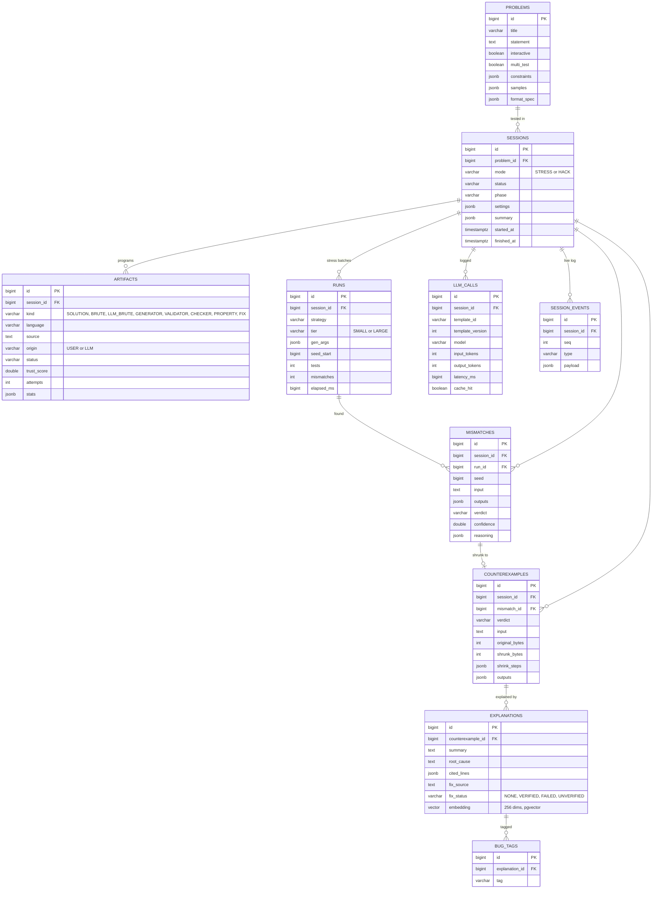

# Database Design

**PostgreSQL 16** is the single source of truth. The schema is managed by **Flyway** migrations and accessed through
Spring Data JPA. Flexible payloads (settings, outputs, reasoning, shrink steps) are stored as `jsonb`; everything that
is queried or joined is a typed column.

Redis holds only the job queue, cancel flags and the LLM cache, so losing it loses no results.

## Entity-relationship diagram

## Tables

| Table | Content | Notes |
|---|---|---|
| `problems` | statement, constraints, samples, input format model | samples are copied verbatim from the statement |
| `sessions` | mode, status, phase, settings, summary, timings | the summary records toolchain versions, model, prompt versions and limits |
| `artifacts` | every program: solution, brute forces, generator, validator, checker, property checkers, fixes | status, trust score and number of LLM attempts |
| `runs` | one stress batch: strategy, tier, generator arguments, seed range, counts, timing | makes every test reproducible |
| `mismatches` | every disagreement with all outputs, its verdict, confidence and reasoning | inputs over 64 KiB are stored as a preview plus the command that regenerates them |
| `counterexamples` | shrunk input, every shrink step, re-verified outputs | `original_bytes → shrunk_bytes` |
| `explanations` | root cause, cited lines, fix, fix status and verification details | optional `embedding vector(256)` |
| `bug_tags` | tags per explanation | drives the bug statistics page |
| `llm_calls` | every LLM call: template, version, model, tokens, latency, cost, cache hit, errors | observability and cost tracking |
| `session_events` | the live event log, `UNIQUE (session_id, seq)` | replayed to dashboards opened late |

All child tables use `ON DELETE CASCADE` from `sessions`, so deleting a session removes its evidence cleanly.

## Design choices

- **Plain ids, no JPA associations.** Entities hold numeric foreign-key columns instead of mapped relationships, so
  the long-running pipeline never hits lazy-loading problems outside a transaction.
- **`jsonb` for evidence.** Outputs, reasoning and shrink steps vary by verdict; storing them as JSON keeps the full
  evidence without a dozen side tables, and the API returns them as they are.
- **Optional pgvector.** The `embedding` column is added by a separate migration that runs only when pgvector is
  enabled. Without it, similar bugs fall back to tag overlap.
- **Deterministic embeddings.** Similar-bug search uses a 256-dimension feature-hashing embedding computed in Java, so
  it works offline and with any LLM, with no embedding API.
- **Indexes** on `session_id` for every child table, `sessions (created_at DESC)` for the history page and
  `bug_tags (tag, created_at)` for statistics.
