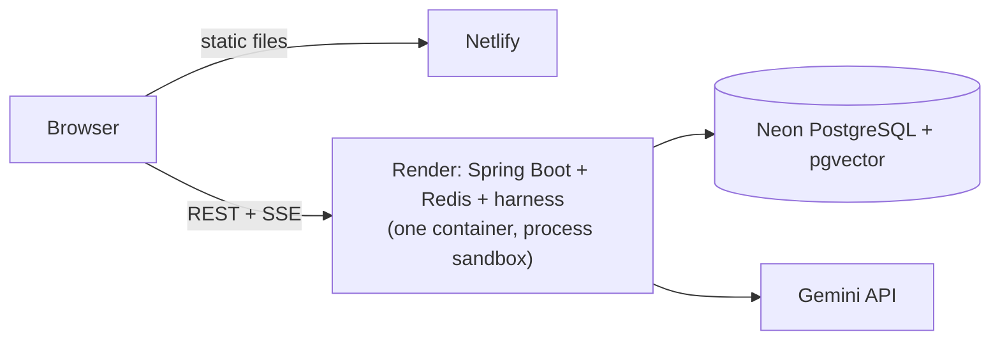

# Setup & Deployment

StressBugger runs three ways: on a laptop with Docker, on free hosting, or on a Linux server with HTTPS. The source
code is private; this page describes how the original project is run.

---

## 1. Local (Docker Compose)

**Requirements:** Docker with Compose v2, Git, 16 GB RAM (8 GB with the small model) and ~15 GB of disk.

```powershell
# Windows (PowerShell)
.\setup.ps1
```

```bash
# Linux / macOS
./setup.sh
```

The setup script checks the machine, writes `.env` with random secrets (on Windows it also detects an NVIDIA GPU), builds the images,
downloads the model and waits until every component is healthy. Then open <http://localhost:5173>; the **Status** page
shows each component.

| Variable | Default | Meaning |
|---|---|---|
| `STRESSBUGGER_LLM_PROVIDER` | `ollama` | `ollama`, `gemini`, `anthropic` or `mock` |
| `OLLAMA_MODEL` | `qwen2.5-coder:7b` | `3b` for 8 GB machines, `14b` for a GPU or 24 GB RAM |
| `STRESSBUGGER_WORKERS` | `2` | sessions that run at the same time |
| `STRESSBUGGER_MAX_QUEUED` | `20` | sessions that may wait (then HTTP 429) |
| `STRESSBUGGER_ACCESS_TOKEN` | empty | required on a public server |
| `STRESSBUGGER_CORS_ORIGINS` | empty | the frontend's origin when it is hosted elsewhere |
| `STRESSBUGGER_SANDBOX_MODE` | `docker` | `process` for hosts without Docker |

- No strong machine? `STRESSBUGGER_LLM_PROVIDER=gemini` with a free `GEMINI_API_KEY`.
- Fully offline demo: `STRESSBUGGER_LLM_PROVIDER=mock` answers for the 7 bundled demo problems.

### Development mode

Dependencies run in Docker; the backend (`mvnw spring-boot:run`, port 8090) and the frontend (`npm run dev`, port
5173, proxying `/api`) run on the host with JDK 21 and Node 24.

---

## 2. Free hosting: Netlify + Render + Neon (the live demo)

| Piece | Service | Notes |
|---|---|---|
| Frontend | **Netlify** | static React build, uploaded from the developer's machine |
| Backend | **Render** free web service | one Docker image; 512 MB RAM; sleeps after 15 min idle, wakes in ~1 min |
| Database | **Neon** free PostgreSQL | pgvector included; data survives restarts |
| LLM | **Gemini** free tier | |



How the backend fits a free host:

- Render has no Docker inside, so programs run as child processes (`STRESSBUGGER_SANDBOX_MODE=process`) with the same
  time, memory and output limits ([security](sandbox-and-security.md#process-mode-hosts-without-docker)).
- Redis runs inside the same container; it only holds the queue and a cache.
- JVM settings keep a whole session under 512 MB (measured peak: ~480 MB).
- The backend redeploys automatically on every push to `main`; Render's GitHub app keeps access when the repository
  is private.

---

## 3. Your own Linux server

**Requirements:** Ubuntu 22.04/24.04 (x86_64 or ARM64), 4+ cores, 12+ GB RAM for the 7B model, 30 GB of disk, a DNS
name and ports 80/443.

```bash
deployment/scripts/install.sh --install-docker --open-firewall   # checks, Docker, firewall, .env with secrets
deployment/scripts/start.sh                                      # build, pull the model, wait until healthy
```

- Only **Caddy** listens on 80/443, with an automatic Let's Encrypt certificate.
- The production overlay refuses to start without an access token and a database password.
- Day-to-day scripts: `health-check.sh`, `backup.sh` (keeps the newest 14 dumps), `restore.sh`, `update.sh`
  (backup, pull, rebuild, restart), `stop.sh`. Windows equivalents exist as `.ps1`.

### Sizing

| Machine | Model | Notes |
|---|---|---|
| 8 GB RAM | `qwen2.5-coder:3b` | one worker; slow on CPU |
| 16 GB RAM | `qwen2.5-coder:7b` (default) | comfortable |
| 24 GB RAM | `qwen2.5-coder:14b` | better programs, slower on CPU |
| NVIDIA GPU, 8+ GB | `7b` or `14b` | answers in seconds |

Stress testing itself is fast (about 1,000 tests per minute per session); on a CPU the LLM is the slow part.
