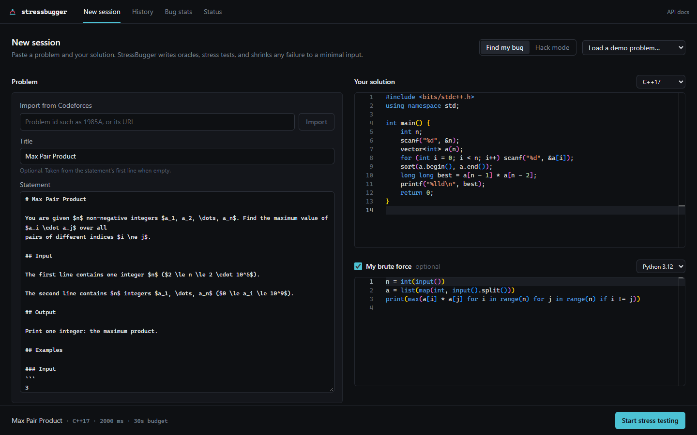
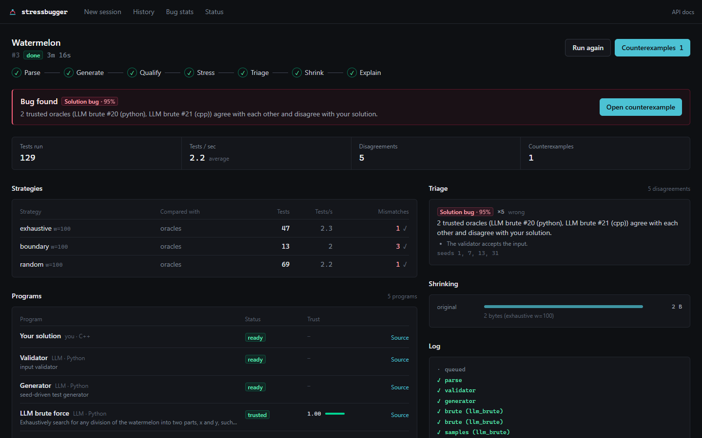
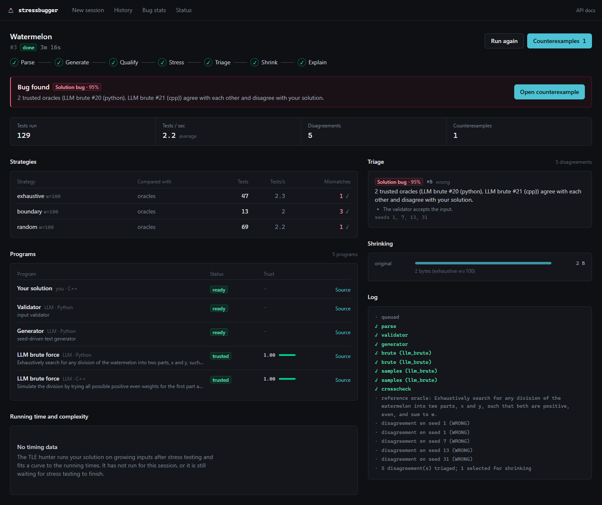
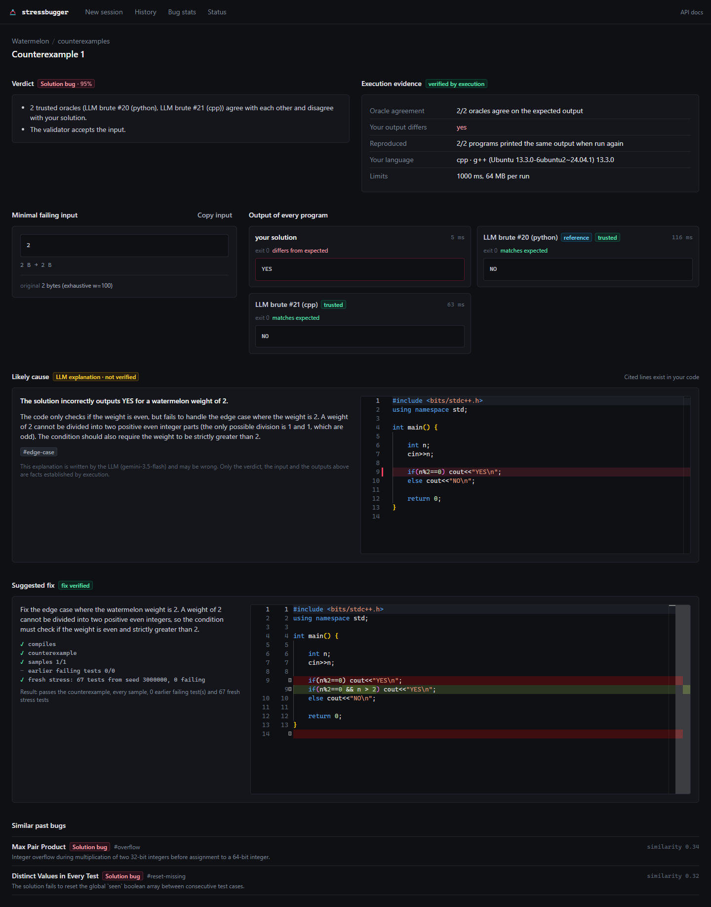
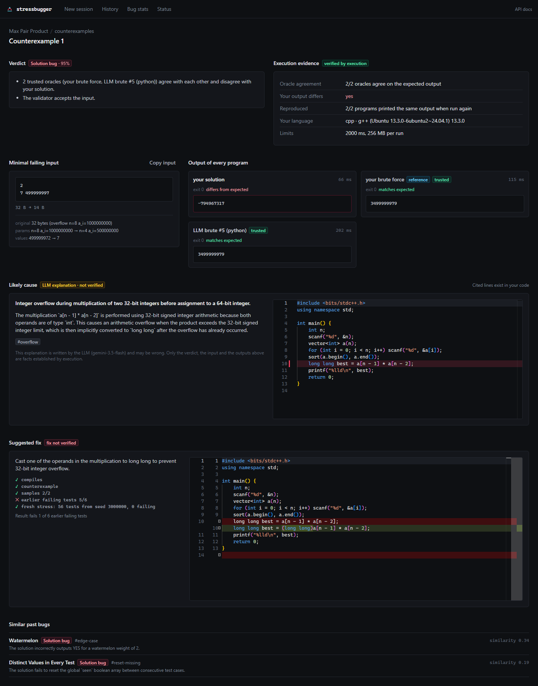
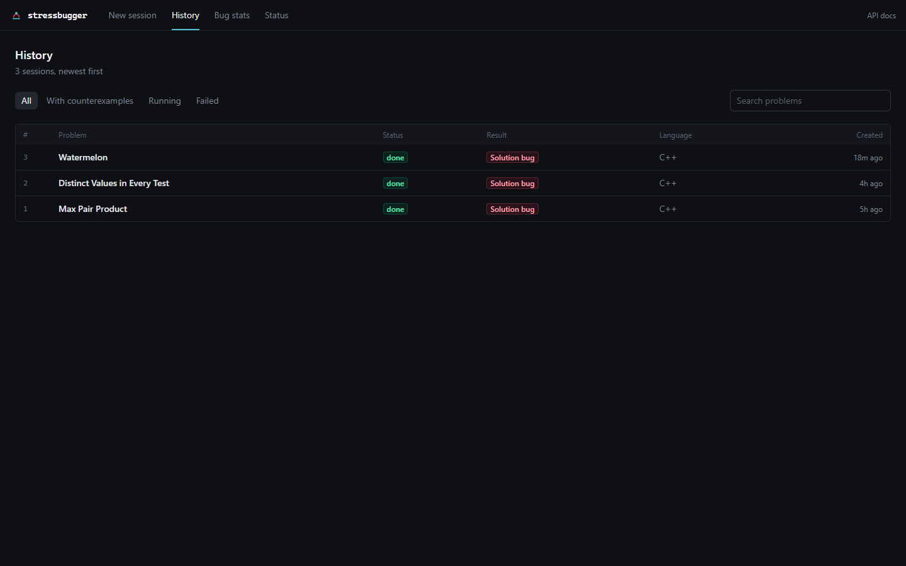
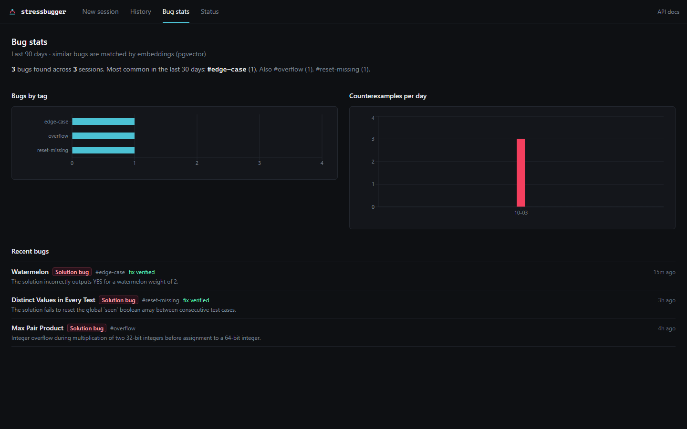
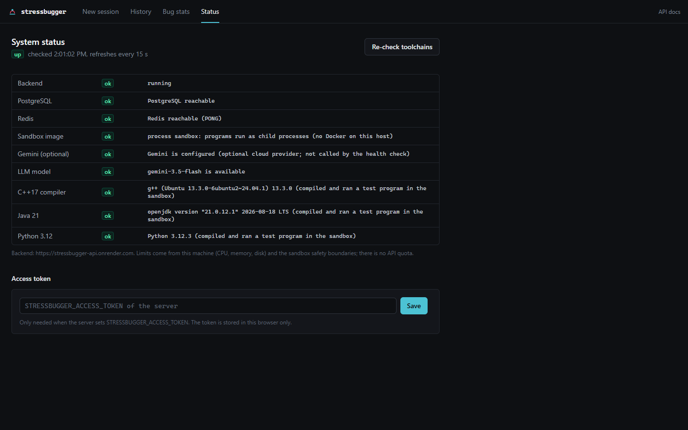
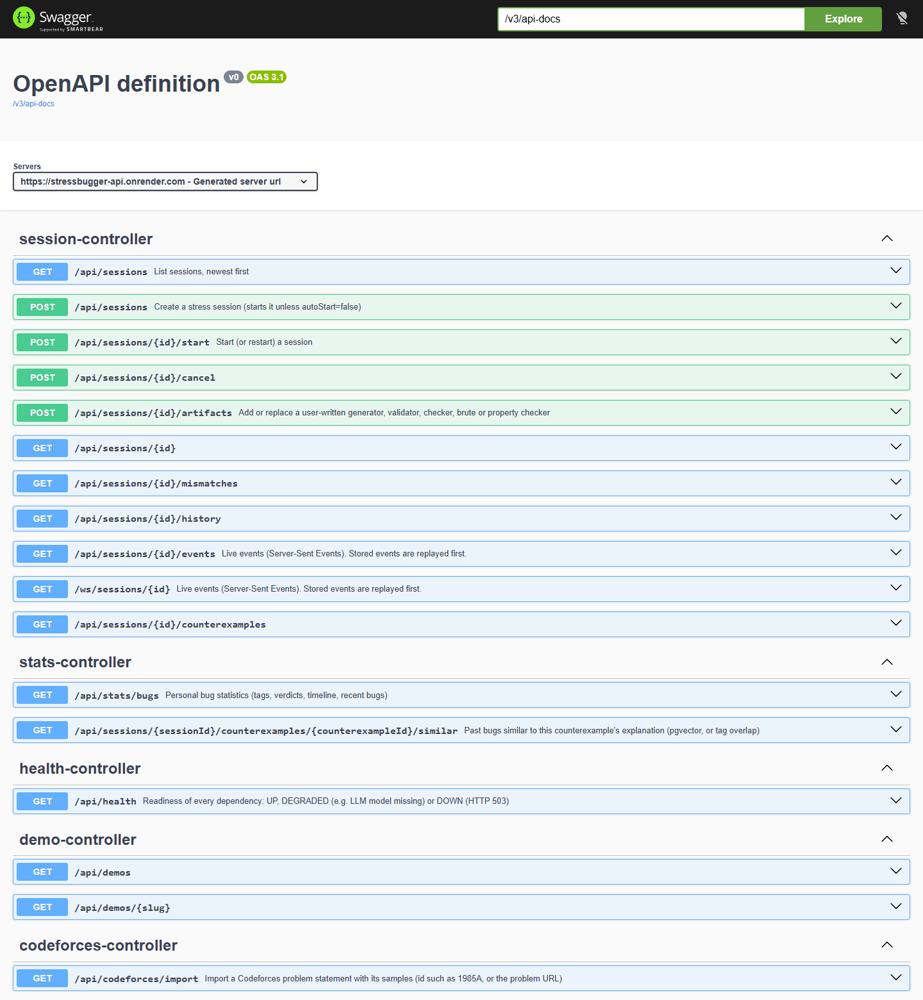

# 🖼️ Screenshot Gallery

Every screenshot is taken from the **live hosted demo** ([stressbugger.netlify.app](https://stressbugger.netlify.app))
running real sessions with Gemini on Render + Neon. Nothing is mocked.

---

## 1. New session
Import a Codeforces problem by id or URL, load a demo, or paste any statement. Paste your solution (C++17, Java 21 or
Python 3.12) and, optionally, your own brute force. *Find my bug* checks your own code; *Hack mode* frames the same
pipeline as breaking someone else's.

## 2. Live session dashboard
Each phase streams live: **Parse → Generate → Qualify → Stress → Triage → Shrink → Explain**. The strategies table
shows every test batch; the programs list shows each LLM-written program with its status and trust score.

Full page: programs, triage, shrinking and the session log

## 3. Counterexample with a verified fix (Codeforces 4A "Watermelon")
- **Verdict** with confidence and reasoning: 2 trusted oracles in different languages agree with each other and
  disagree with the solution.
- **Execution evidence:** oracle agreement, reproduction, toolchain and limits.
- **Output of every program** on the minimal input `2`.
- **Likely cause** from the LLM, with the cited line highlighted in the code, clearly labelled as an unverified
  explanation.
- **Suggested fix** as a diff, labelled **fix verified** after: compile ✓, counterexample ✓, samples ✓, fresh stress
  run of 67 tests ✓.
- **Similar past bugs** via pgvector.

## 4. Counterexample where the fix is *not* verified (integer overflow)
The failing input was shrunk from 32 to 14 bytes (`n=8, a_i=10⁹` → `2` / `7 499999997`). The LLM's fix passed the
counterexample and the samples but failed 1 of 6 earlier failing tests, so StressBugger refuses to call it verified.

## 5. History
Every session is stored with its result and can be reopened and replayed.

## 6. Bug stats
Bugs by tag, counterexamples per day and recent bugs with their fix status.

## 7. System status
Every component is checked; for each language a real program is compiled and run in the sandbox.

## 8. API documentation (Swagger UI)

---

*Note for reviewers:* the hosted demo uses the free-hosting **process sandbox**; the default Docker deployment runs
each session in its own hardened container. See [sandbox & security](../docs/sandbox-and-security.md).
